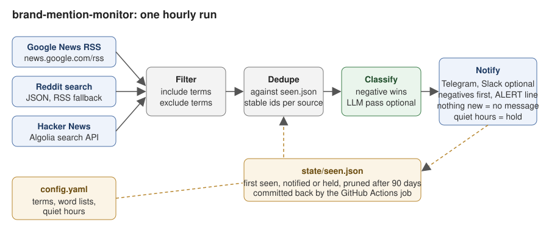

# brand-mention-monitor

An hourly brand mention monitor that needs no paid tool. It checks Google News, Reddit and Hacker News for your terms, remembers what it has already seen, tags each new mention negative, neutral or positive, and sends the new ones to Telegram (and Slack if you want). Runs on GitHub Actions for free.

Built by [Niket Jain](https://niketjain.pages.dev). MIT licence. The sample config watches a fictional brand, Kestrel Systems.

## What it does

- Searches three free sources every hour: Google News RSS, Reddit search (JSON, with an RSS fallback when Reddit blocks the JSON endpoint) and the Hacker News Algolia API.
- Keeps only mentions that contain one of your include terms and none of your exclude terms, so "Kestrel Systems" does not drown in birdwatching.
- Dedupes with `state/seen.json`, which the GitHub Actions job commits back to the repo. A mention is sent once, ever.
- Classifies each mention with keyword lists you own. Negative words win. An optional LLM pass (Claude or Gemini, behind a flag and an environment key) can refine the verdict.
- Sends one Telegram message per run with the new mentions, negatives first, with a separate ALERT line when any are negative. A quiet hour means no message: nothing new, nothing sent.
- Holds alerts during quiet hours (for example 23:00 to 07:00) and sends them with the next run outside the window.

## Why it exists

Paid listening tools start at a few hundred dollars a month and most small marketing teams need five percent of what they do: tell me when someone writes about us, and shout if it is bad. The three sources here are public, free and good enough for that.

## Run it in three commands

```
pip install -r requirements.txt
python -m pytest -q
python -m monitor run --dry-run
```

`--dry-run` prints the alert instead of sending it. Set `TELEGRAM_BOT_TOKEN` and `TELEGRAM_CHAT_ID` and drop the flag to send for real. To look at the sources for any term without touching the state file:

```
python -m monitor fetch --term "Raspberry Pi" --limit 2
```

Real output from that command on 22 Oct 2026 (long Google News links trimmed):

```
  google_news: 2 results for 'Raspberry Pi'
  reddit: 2 results for 'Raspberry Pi'
  hacker_news: 2 results for 'Raspberry Pi'

[NEUTRAL] Google News, Hackster.io: You Can Now Talk to Your Raspberry Pi Pico Over SSH - Hackster.io
  https://news.google.com/rss/articles/CBMi...?oc=5  (2026-10-22T05:49:13+00:00)
[NEUTRAL] Google News, LinuxGizmos.com: Linux-based industrial Pi controller supports stackable I/O modules - LinuxGizmos.com
  https://news.google.com/rss/articles/CBMi...?oc=5  (2026-10-22T03:07:26+00:00)
[NEUTRAL] Reddit r/ArduinoHelp: Arduino Uno w/ Aas608
  https://www.reddit.com/r/ArduinoHelp/comments/1xceesa/arduino_uno_w_aas608/  (2026-10-22T10:00:57+00:00)
[NEUTRAL] Hacker News comment: There isn't an easy exploit for this PHP vulnerability
  https://news.ycombinator.com/item?id=50193308  (2026-10-22T09:54:15+00:00)
[POSITIVE] Hacker News comment: Ask HN: Which companies do you admire and why?
  https://news.ycombinator.com/item?id=50191854  (2026-10-22T06:20:57+00:00)
```

And a real `run --dry-run` with the sample terms, which finds nothing because the brand is fictional:

```
Checking 2 term(s) at 2026-10-22T10:24+00:00
  google_news: 24 results for 'Kestrel Systems'
  hacker_news: 25 results for 'Kestrel Systems'
  ...
  78 fetched, 0 match the terms, 0 new, 0 held from earlier
  Nothing new. No message sent.
  State saved to state/seen.json (0 ids, 0 old ones pruned)
```

The sources search loosely (78 results for a brand that does not exist, all of them about kestrels), which is why the exact phrase has to appear in the title or text before a mention counts.

## How it works



1. For every include term and every enabled source, fetch the latest results (25 per source by default). A source that fails is logged and skipped; the run goes on.
2. Keep mentions whose title or text contains an include term as a whole phrase (`strict_match: true`) and none of the exclude terms.
3. Drop anything already in `state/seen.json`. Ids are stable per source: a hash of the link for news, the post id for Reddit, the object id for Hacker News.
4. Classify: the first negative word found wins, then the first positive word, else neutral. With `--llm` and a key, the model gets one call with all the new mentions and can overrule the keywords.
5. If it is a quiet hour, remember the mentions as held and stop. Otherwise send one message with the new and held mentions, negatives first.
6. Save the state. Entries older than `keep_days` are pruned, except held ones.

The alert looks like this (from the test fixtures):

```
3 new mentions of Kestrel Systems, Kestrel Fleet
ALERT: 1 negative (matched: outage)

[NEGATIVE] Google News, Logistics Today (fictional): Customers report outage at Kestrel Systems after weekend update
https://news.example/logistics-today/kestrel-outage
[NEUTRAL] Google News, Fleet Weekly (fictional): Kestrel Systems launches predictive maintenance for mid size fleets
https://news.example/fleet-weekly/kestrel-launch
...
```

## Configuration

Everything is in `config.yaml`:

| Key | What it does |
| --- | --- |
| `terms.include` | Phrases to watch. Whole words, any case |
| `terms.exclude` | Drop a mention if it contains any of these |
| `terms.strict_match` | `true`: the phrase must be in the title or text we get back. `false`: trust the source search |
| `sources` | Switch `google_news`, `reddit`, `hacker_news` on or off |
| `limits.per_source` | Results per source per term per run |
| `classify.negative`, `classify.positive` | Word lists. Negative wins |
| `notify.telegram`, `notify.slack` | Which channels to use |
| `quiet_hours` | `timezone`, `start`, `end` in whole hours. Alerts are held, not lost |
| `state_file`, `keep_days` | Where the seen file lives and how long ids are kept |

Secrets come from the environment, never from the file: `TELEGRAM_BOT_TOKEN`, `TELEGRAM_CHAT_ID`, `SLACK_WEBHOOK_URL`, and for `--llm` either `ANTHROPIC_API_KEY` or `GEMINI_API_KEY`.

### Telegram setup in two minutes

1. Message @BotFather on Telegram, send `/newbot`, copy the token.
2. Start a chat with your new bot (or add it to a group) and send it any message.
3. Open `https://api.telegram.org/bot<TOKEN>/getUpdates` in a browser and copy the `chat.id`.
4. Add both as repository secrets: `TELEGRAM_BOT_TOKEN`, `TELEGRAM_CHAT_ID`.

## GitHub Actions

`.github/workflows/monitor.yml` runs every hour at :07 and on demand. It installs, runs the monitor (and retries once after 60 seconds if the first try fails), then commits `state/seen.json` back as `github-actions[bot]` when it changed. The workflow needs `contents: write`, which it declares, and nothing else. The `concurrency` group stops two runs from pushing the state file at the same time.

GitHub pauses scheduled workflows on repos with no activity for 60 days; the state commits count as activity, so a repo that finds mentions keeps itself alive.

## Tests

`tests/fixtures/` holds saved responses in the real formats (Google News RSS, Reddit JSON and Atom, Hacker News Algolia JSON) with fictional content, so `pytest` runs offline. The tests cover parsing, stable ids, dedupe, the state round trip, held mentions, pruning, term matching, classification, the message layout and quiet hours across midnight.

## Limits

- Reddit blocks its JSON search from many networks (403) and rate limits the RSS search (429). The tool falls back to RSS and waits on 429, but a busy hour can still lose the Reddit pass. The other two sources are reliable.
- Google News only gives titles, so a mention that names you in the body but not the headline is missed when `strict_match` is on.
- Keyword sentiment is blunt. "Would love to hear if it is any good" reads as positive. Read the ALERT lines yourself; use `--llm` if you want a second opinion.
- Sources are polled, not streamed. Expect up to an hour of delay plus whatever the source itself takes to index.
- Telegram messages are split at 3900 characters, so a very busy hour arrives as several messages.

## Licence

MIT. Copyright 2026 Niket Jain.
